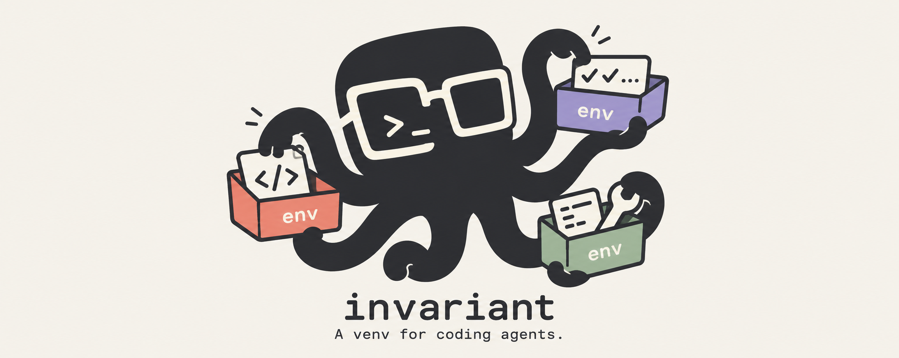

# INVARIANT

**Persistent Linux environments for coding agents, with optional restrictions.**

Give each project its own Linux environment with tools and settings that survive
between runs. Work with one agent, or run configurations in parallel on the same
task, evaluate them with shared checks, and review the changes you want to keep.

Think of it as **a venv for coding agents**: a whole development environment,
including system packages, language runtimes and home-directory configuration.
Docker supplies the Linux runtime; INVARIANT manages agent sessions, saved
environments and parallel experiments around it.

[](https://github.com/Xenox-developer/invariant/actions/workflows/python.yml)
[](https://github.com/Xenox-developer/invariant/actions/workflows/rust-libraries.yml)

[Environments](https://github.com/Xenox-developer/invariant/blob/main/docs/ENVIRONMENT_ARCHITECTURE.md) ·
[Experiments](https://github.com/Xenox-developer/invariant/blob/main/docs/experiments/README.md) ·
[Examples](https://github.com/Xenox-developer/invariant/blob/main/examples/projects/README.md) ·
[Issues](https://github.com/Xenox-developer/invariant/issues) ·
[Contributing](https://github.com/Xenox-developer/invariant/blob/main/CONTRIBUTING.md)

**Status: beta, 0.3.x.** See [compatibility](https://github.com/Xenox-developer/invariant/blob/main/docs/COMPATIBILITY.md)
and [release verification](https://github.com/Xenox-developer/invariant/blob/main/docs/RELEASE_VERIFICATION.md)
for tested versions, platforms and known limits.

## What you can do

- **Give agents their own tools.** Install Linux-compatible packages, compilers
  and dependencies inside the project's environment.
- **Pick up where you left off.** Reopen saved Codex chats with the project's
  files, installed software and settings.
- **Try configurations in parallel.** Start trials from one frozen project
  snapshot and prepared image, with separate files and writable environments.
- **Check results consistently.** Evaluate each candidate with the same captured
  tests; inspect test verdicts, runtime and available token usage.
- **Keep the changes you choose.** Review a diff, continue a selected result,
  or apply it through a reviewed plan.
- **Automate the same workflow.** People and assistants use the same commands,
  saved IDs and JSON interface. Export Markdown, JSON or CSV reports.

## A real parallel run

The included demo asks three Codex configurations to implement one calendar
utility and runs the same 23 checks on each result. This excerpt comes from the
macOS arm64 release-verification run on October 24, 2026, using `gpt-6.1-sol`:

```text
Choice | effort | tests passed | agent seconds | tokens | state
1 | low | 23/23 | 21.8 | 28259 | succeeded
2 | medium | 23/23 | 22.3 | 28383 | succeeded
3 | high | 23/23 | 28.3 | 47114 | succeeded
```

All three passed; you choose which result to inspect, continue or apply. These
are recorded measurements from one task and one attempt per configuration,
not a ranking of models. New runs can differ. See the
[demo guide](https://github.com/Xenox-developer/invariant/blob/main/docs/experiments/DEMO.md)
and [verification record](https://github.com/Xenox-developer/invariant/blob/main/docs/RELEASE_VERIFICATION.md).

## Install

| Requirement | Supported setup |
|---|---|
| Host | macOS or Linux; full host verification covers macOS arm64 and Linux x86_64 |
| Python | 3.11 or newer |
| Runtime | A running Linux-container Docker engine; Docker Desktop on macOS |
| Native Codex | CLI 0.163.0, including supported prereleases, and host ChatGPT sign-in |

Install the released CLI into a host virtual environment:

```sh
python3 -m venv ~/.venvs/invariant
. ~/.venvs/invariant/bin/activate
python3 -m pip install "invariant-workspace==0.3.1"
invariant --version
```

Expected: `invariant 0.3.1`. The package is published on
[PyPI](https://pypi.org/project/invariant-workspace/0.3.1/). You can also install
the wheel from the [0.3.1 beta release](https://github.com/Xenox-developer/invariant/releases/tag/v0.3.1)
after checking its SHA-256 against `SHA256SUMS`. See
[installation, updates and removal](https://github.com/Xenox-developer/invariant/blob/main/docs/INSTALLATION.md).

## Start your first environment

Check host tools and sign in once:

```sh
invariant setup
invariant login
```

`setup` detects Docker and the supported Codex CLI and offers missing
installations. Rust, Node/npm and a globally installed Codex are not required
on the host. Finish Docker Desktop's first-launch setup if prompted.

In your existing project directory:

```sh
invariant init
invariant run
```

The first run prepares the Linux image and opens a Codex chat. Ask the agent
to work on your project. It can install the Linux-compatible tools it needs;
ordinary sessions work on a Docker-backed project copy; reviewed task results can be applied to the original project.

New environments have internet access by default, so the agent can download and
install the Linux-compatible packages it needs without a separate setup step.
Installed tools and dependencies are saved with the environment.

Agent installations, settings, plugins, caches, chats and working copies live in
Docker volumes and images. The host retains source files, exported results and
logs, and a small volume registry. Internet is enabled; resource quotas and
workload deadlines are off by default. Agents never receive the host home,
Docker socket, devices or privileged execution. Only the trusted manager controls Docker.

Optional resource/network restrictions remain available:

```sh
invariant config set restrictions_enabled true
invariant storage status --json
invariant storage migrate --all
```

Set `restrictions_enabled false` to disable optional limits again. It does not
grant access to the host. See [Docker state storage](docs/DOCKER_STORAGE.md).

Automatic Docker maintenance checks hourly while idle and removes disposable
objects older than 30 days. Results, logs and saved task/continuation state do not
expire. Inspect or change the policy with `invariant storage maintenance --json`;
preview cleanup with `invariant storage cleanup --json`.

To work offline, exit with `/exit`, disable networking, and resume:

```sh
invariant config set command_network none
invariant resume
```

Existing projects keep their saved network setting. If an older project has
networking disabled, enable it once with
`invariant config set command_network internet` before running or resuming.

After `/exit` or closing the terminal, return to the same project and run:

```sh
. ~/.venvs/invariant/bin/activate
invariant resume
```

`resume` continues the saved chat. A new `invariant run` starts a new conversation
using the project's saved environment. See
[sessions and configuration](https://github.com/Xenox-developer/invariant/blob/main/docs/CODEX_WORKSPACE.md).

### What survives between runs?

| State | Behavior |
|---|---|
| Project files | Remain in your project directory |
| Installed packages, runtimes, home files and settings | Saved when the environment stops; reused on the next run or resume |
| Codex conversation | Saved separately; continued with `invariant resume` |
| Running processes, services, memory and open connections | Stop with the environment; services must be started again |

Each project has its own environment. This goes beyond a Python dependency
directory or a separate Git checkout: the installed Linux toolchain and home
configuration are saved too. See the
[environment lifecycle and boundaries](https://github.com/Xenox-developer/invariant/blob/main/docs/ENVIRONMENT_ARCHITECTURE.md).

## Run parallel experiments

### Try the included task

```sh
invariant experiment demo ~/invariant-codex-demo --run
```

This creates a separate project and requests three parallel Codex configurations
with shared checks. Actual concurrency depends on Docker CPU/RAM. The first run
uses three real model turns from your signed-in account; continuing a result
uses another turn. Configurations share provider limits.

Omit `--run` to create and inspect the demo without Docker, sign-in or model
calls. Repeating the same demo command reopens its saved study without replaying
completed turns. See the [detailed demo](https://github.com/Xenox-developer/invariant/blob/main/docs/experiments/DEMO.md)
or the [command-only quickstart](https://github.com/Xenox-developer/invariant/blob/main/docs/experiments/QUICKSTART.md).

### Use your own project

Inside an initialized project, run:

```sh
invariant experiment init
```

The guided setup asks for a task, a Linux test command, fixed test files and
agent configurations. It checks that evaluation can run before starting model
calls. Trials work on private project copies and deliver results through an
explicit apply step. Comparisons export each variant separately and never choose or apply a winner automatically.

Prepare missing dependencies with an ordinary agent session or an explicit
`invariant environment prepare --command "YOUR_LINUX_SETUP_COMMAND"`.
New environments already allow downloads; existing offline projects keep their
saved policy. Installed tools become
part of the project's saved environment and the baseline for new experiments.
See [environment preparation](https://github.com/Xenox-developer/invariant/blob/main/docs/ENVIRONMENT_PREPARATION.md)
and [guided experiments, flags and JSON](https://github.com/Xenox-developer/invariant/blob/main/docs/experiments/GUIDED_SETUP.md).

### Review and keep a result

```sh
invariant experiment list
invariant experiment review STUDY_ID
invariant experiment export STUDY_ID --output comparison.md
```

Replace `STUDY_ID` with an ID from `list`. Review lets you inspect diffs, choose
a result, continue it with its saved files/tools in a fresh conversation, or
review and apply a concrete plan. Selecting a result changes no project files.

Closing a viewer leaves detached experiments running. Return with `review`,
follow `logs STUDY_ID --follow`, or use `stop STUDY_ID`. Interrupted work has
explicit recovery and retry commands. See the
[experiment reference](https://github.com/Xenox-developer/invariant/blob/main/docs/experiments/README.md)
and [storage, backups and recovery](https://github.com/Xenox-developer/invariant/blob/main/docs/STORAGE_AND_RECOVERY.md).

## Use from an AI assistant

For related jobs, use a [reusable execution context](docs/EXECUTION_CONTEXTS.md).
It shares preparation and runtime caches while retaining independent worker
snapshots. `invariant context --help` exposes prepare, submit, execute, status and
explicit collection. New projects select a compact coding tool profile separately
from network access and resource limits.


The optional [INVARIANT skill](https://github.com/Xenox-developer/invariant/blob/main/skills/invariant/SKILL.md) teaches an assistant to
prepare environments, submit coding tasks, inspect results and apply reviewed
changes through the existing CLI. It requires an installed INVARIANT CLI and
shell access. It defaults to one executor; comparisons use multiple configurations
when requested.

The coordinated workflow is available in the current checkout through
`invariant task execute`; check `invariant task --help` before using the skill with
an older installed release. It owns preparation, baseline checks, dispatch and
waiting as one durable request. A bounded semantic reviewer runs after execution;
provider response usage is saved and reconciled with session totals. New child
evaluations are frozen independently from their saved workspace/tools. Compact
review packages bind application to a
concrete plan; private continuation snapshots retain caches without applying them
to the host. See [task automation](https://github.com/Xenox-developer/invariant/blob/main/docs/TASK_AUTOMATION.md) for
resumption, package download retries and verified comparison contracts.

For Codex, copy the skill from the repository root into your personal skills
directory (the command leaves an existing installation alone):

```sh
mkdir -p ~/.codex/skills
test ! -e ~/.codex/skills/invariant && test ! -L ~/.codex/skills/invariant && \
  cp -R skills/invariant ~/.codex/skills/invariant
```

The entire folder is portable, including its two reference files. Other agents
that support `SKILL.md` can load the same folder through their skill mechanism.
Example requests:

- `$invariant Implement the requested fix in this project, run its tests, and apply the reviewed result.`
- `$invariant Compare low, medium and high effort on this task and show me the results.`
- `$invariant Prepare this project's Linux dependencies without model calls.`

See the [assistant and JSON interface](https://github.com/Xenox-developer/invariant/blob/main/docs/experiments/ASSISTANT_GUIDE.md) for the
underlying command contract. The skill does not add a separate server or API.

## Supported agents

| Workflow | Integration |
|---|---|
| Interactive environment and saved chat | Native Codex CLI integration with host ChatGPT sign-in |
| Parallel native experiments | Codex model/effort configurations, shared evaluation and reported usage |
| Other command-based agent harnesses | Advanced experiment recipes invoking Linux commands; install and configure your harness explicitly |

Other harnesses do not inherit Codex's chat-resume, account integration or token
reporting automatically. Python, JavaScript and other Linux-compatible task
stacks can run inside the environment. Packaged
[Python and JavaScript examples](https://github.com/Xenox-developer/invariant/blob/main/examples/projects/README.md)
include dependency preparation and tests.

## Limits and privacy

- Native Codex sends task content and tool results to the provider. Local
  environments do not mean local model inference. Credentials stay outside the
  workload containers.
- Agents run as administrator inside Docker. Unrestricted defaults include host
  home, local Docker access and available devices. The restricted preset removes
  host mounts and additional privileges. Internet mode also permits reachable local-network services. See the
  [security boundaries](https://github.com/Xenox-developer/invariant/blob/main/SECURITY.md).
- Environments use Linux on Docker. Native macOS/Windows kernels and process-memory
  restoration are outside this backend. Device/GPU passthrough and host networking
  depend on Docker's platform support; Docker Desktop may need host networking
  enabled in its own settings. Host Docker access can launch other containers.
- Experiments use full workspace copies and saved Docker layers. Leave disk
  headroom; hard disk quotas are not provided.
- Shared checks make evaluation consistent, but model responses are not
  deterministic. Tests are not an attestation against adversarial code.
- Applying results requires review and performs no automatic merge. Private
  backups are unencrypted and restore to matching paths. Detailed logs and
  exports can contain project content; inspect them before sharing.

## Embed the Rust libraries

Embed the capability policy and execution broker in a Rust host with Rust 1.90+.
Both packages are available on crates.io:
[invariant-workspace-core](https://crates.io/crates/invariant-workspace-core/0.1.0) and
[invariant-broker](https://crates.io/crates/invariant-broker/0.1.0).

```toml
[dependencies]
invariant-core = { package = "invariant-workspace-core", version = "0.1.0" }
invariant-broker = "0.1.0"
```

The alias preserves `invariant_core` imports; `invariant_broker::core` exposes the
same policy types. Rust embedding needs no Docker, Python or Codex. See the
[embedding guide](https://github.com/Xenox-developer/invariant/blob/main/docs/RUST_LIBRARY.md)
for examples and the libraries' fixed capability scope.

## Documentation and contributing

- [Persistent environment architecture](https://github.com/Xenox-developer/invariant/blob/main/docs/ENVIRONMENT_ARCHITECTURE.md)
- [Host setup and troubleshooting](https://github.com/Xenox-developer/invariant/blob/main/docs/SETUP.md)
- [Complete experiment interface](https://github.com/Xenox-developer/invariant/blob/main/docs/experiments/README.md)
- [Assistant and JSON interface](https://github.com/Xenox-developer/invariant/blob/main/docs/experiments/ASSISTANT_GUIDE.md)
- [Compatibility and upgrades](https://github.com/Xenox-developer/invariant/blob/main/docs/COMPATIBILITY.md)
- [Standalone Rust libraries and embedding](https://github.com/Xenox-developer/invariant/blob/main/docs/RUST_LIBRARY.md)
- [Changelog](https://github.com/Xenox-developer/invariant/blob/main/CHANGELOG.md)
- [Contributing and tests](https://github.com/Xenox-developer/invariant/blob/main/CONTRIBUTING.md)
- [Maintainer release process](https://github.com/Xenox-developer/invariant/blob/main/docs/PUBLISHING.md)

For help, bug reports or feature proposals, [open an issue](https://github.com/Xenox-developer/invariant/issues).
Include your command, version, a small reproduction and sanitized
`invariant doctor --json` output. Report vulnerabilities through
[private security reporting](https://github.com/Xenox-developer/invariant/security/advisories/new).

## License

Original INVARIANT source is [Apache-2.0](https://github.com/Xenox-developer/invariant/blob/main/LICENSE).
See [NOTICE](https://github.com/Xenox-developer/invariant/blob/main/NOTICE) and the
[licensing inventory](https://github.com/Xenox-developer/invariant/blob/main/docs/LICENSING.md)
for third-party components. Docker Desktop, Codex and provider accounts retain
their own terms.

Related stages can pass accepted files using digest-bound `result_inputs`, entirely
inside Docker. Run contexts keep a manager connection open, expose compact status,
and collect results explicitly with optional log cursors. Background Codex recipes
can select `runner.completion: validated` to finish from a protected acceptance
receipt without an extra model-written final response. Full environment snapshots,
continuation and guarded application remain available. See
[execution contexts](docs/EXECUTION_CONTEXTS.md) for the Python API and guarantees.
