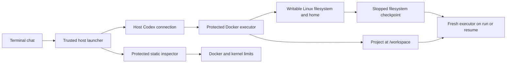

# Persistent general-purpose agent environments

INVARIANT manages an isolated Linux environment, rather than language-specific
dependency directories. The agent chooses its technologies. The general
environment lifecycle has no Python/Node/Rust profiles or package-manager adapters.



## Everyday use

```sh
invariant init
invariant config set command_network internet  # when downloads are needed
invariant run
```

Ask the agent to build the application using whichever Linux-compatible tools it
needs. It is administrator inside the environment and may install system
packages, compilers, runtimes, services and dependencies using their normal
workflows. Virtual environments, symlinks, project-contained hard links, global tool installs, home-directory
configuration and shell profiles are supported. No INVARIANT-specific package
installation path or activation convention is needed. Normal login shells load
custom PATH/setup from `/root/.profile` without a language adapter.

On exit, EOF, terminal hangup, deadline or operator stop, INVARIANT stops the
executor and checkpoints its filesystem before removing its container. The next
run/resume starts a fresh executor from that project's exact saved image.
Installed software, `/root`, `/usr`, `/opt`, `/var/lib` and configuration survive.
Compiler output can execute in temporary scratch; `nosuid` and `nodev` remain
enforced. Project hard links are accepted only if every inode link is accounted
for inside the project tree, so they cannot expose a file elsewhere on the host.
The project is an ordinary host directory mounted at `/workspace`, independent
of the checkpoint. Scratch, process memory, running services and open connections
are temporary. Services must be started again. Filesystem checkpoints are not
application-aware database backups or protection from Docker disk corruption.

Network and resource settings are reapplied from current project policy; they
are never restored from the saved image. Saved software remains usable offline.
Docker-managed hostname/resolver files, kernel filesystems and mount contents
are recreated rather than captured as environment data. The project persists
independently, protected control is reattached, and `/scratch` is temporary.
This follows [Docker's filesystem checkpoint semantics](https://docs.docker.com/reference/cli/docker/container/commit/).
Read-only project access freezes both the project and the environment root;
saved tools remain usable, scratch stays writable and no checkpoint is replaced.

## Ownership and isolation

The agent owns its Linux filesystem, but not the host launcher, account
connection, policy, control executables or checkpoint identity:

- Codex credentials and native chat history remain in private host state,
  outside the environment and its checkpoints.
- The executor and static inspector are extracted only from the pinned base
  image, hashed in private metadata, checked before use and mounted read-only
  at `/__invariant`. Guardrail measurements do not execute mutable interpreters
  or load the environment's packages/shared libraries. The inspector reads
  cgroup/procfs/kernel data directly and disables ordinary ptrace attachment.
- Project policy is overlaid read-only. Executor requirements come from a
  separate read-only installation asset mount.
- No host home, Docker socket, arbitrary host directory, device, published port,
  host namespace or privileged container is exposed. Extra host mounts contain
  only protected control executables and the fixed requirements file.
- Container administrator access includes only CHOWN, DAC_OVERRIDE, FOWNER,
  FSETID, SETGID, SETUID, SYS_CHROOT and SETFCAP for package managers. SYS_ADMIN,
  SYS_PTRACE, NET_ADMIN and NET_RAW are absent. No-new-privileges, namespaces,
  cgroups and seccomp remain enforced.
- Seccomp uses the vendored general Docker/Moby profile, with socket rules
  narrowed for INVARIANT. Offline permits Unix sockets only; internet adds
  IPv4/IPv6 TCP/UDP. Raw/packet sockets and privileged namespace operations remain
  unavailable. The exact upstream revision and license are in the assets.

Writable environments and projects can be modified/deleted by the agent; use
backups/version control for valuable files. On native Linux, container-root
writes can create root-owned project files unless Docker provides user mapping;
Docker Desktop manages its own file sharing. This does not expose other host files.

## Lifecycle module

`invariant/environment.py` owns the interface for protected-control preparation,
saved-image selection, interrupted-session recovery and stopped-environment
preservation. The launcher has no knowledge of how pip, npm, Cargo, apt or future
package managers store files. Resource sizing uses Docker capacity and confirmed
memory pressure, without technology-manifest guesses.

Private `environment.json` binds a checkpoint image ID to the resolved project
path and verified Docker image labels. Snapshots live in Docker's image store,
outside the project. Snapshot filesystems are project data, never trusted control
code: the protected executor is mounted anew from the base image every session.

One project lock covers recovery, execution and saving. INVARIANT stops the old
processes, commits, atomically records the returned image ID, then removes only
the owned container. Failed commits/metadata writes retain the stopped container
and recovery record. Recovery checkpoints that exact orphan before a new session.
No prompt/install/interrupted command is replayed. A missing or foreign saved
image fails explicitly; a clean environment is never silently substituted.

Checkpoints consume Docker disk space. Environment/project disk quotas,
automatic snapshot garbage collection and export/import are not implemented.
Do not delete saved images in Docker Desktop if you need them. Project files and
native chat history are separate from those images.

## Compatibility and scope

New projects use `codex-environment-v2`. Existing projects retain their policy.
To switch explicitly:

```sh
invariant config set profile codex-environment-v2
invariant resume  # or invariant run
```

This grants administrator access inside the isolated OS. The deprecated
`codex-workspace-v1` compatibility profile retains its read-only system and old
Python dependency storage. Migration does not delete project-local dependencies;
use their original explicit path or reinstall normally. Already deleted scratch
packages cannot be recovered. The invoice-broker MVP remains a separate fixed
execution profile with its original acceptance contract.

Technology choice is unrestricted at the language/package-manager layer. This
backend is still Linux on Docker with finite resource and network limits. It
does not promise Windows/macOS kernels, GPUs/devices, kernel modules, nested
Docker daemons, VM workloads or every package's successful installation. Those
capabilities need an appropriate backend and explicit authority, rather than
language profiles or disabled host isolation.

## Verification

```sh
python3 -m unittest discover -s scripts/tests -p 'test_*.py'
python3 scripts/test_general_environment_e2e.py --live gpt-6.1-sol --effort medium
python3 scripts/test_easy_workflow_e2e.py --live --oom
python3 scripts/test_mvp_acceptance.py
```

The general check installs toolchains with apt and dependencies with normal npm
and virtual-environment pip workflows, compiles C/Rust, runs JavaScript/Python,
and verifies offline native resume, shell profiles, crash recovery, read-only
operation, project separation and inspection despite a replaced Python command.
